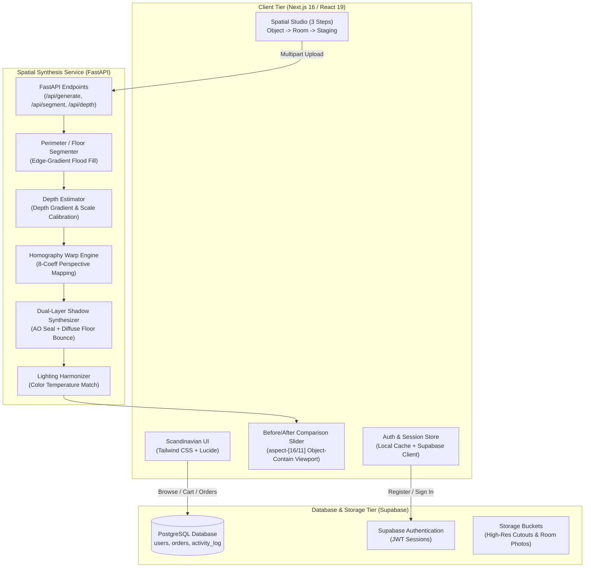

# PIXABUILD // Spatial AI Furniture Commerce

> **Multimodal Spatial AI Commerce Platform & In-Room Visualization Studio**  
> Calibrated for architectural scale, perspective ground alignment, and natural daylight harmonization.

[](https://nextjs.org/)
[](https://fastapi.tiangolo.com/)
[](https://supabase.com/)
[](https://tailwindcss.com/)
[](https://opensource.org/licenses/MIT)

---

## 📌 Overview

**PixaBuild** solves the core challenge of modern furniture e-commerce: **spatial fit uncertainty**. Customers frequently struggle to assess scale, depth, and proportion from isolated studio photographs, leading to high return rates and cart abandonment.

PixaBuild combines a curated Scandinavian furniture store with an **automated in-room spatial staging engine**:
1. Customers browse 36+ verified furniture designs with accurate metric dimensions and Indian Rupee (`Rs.`) pricing.
2. Users choose an architectural room template or upload a photograph of their personal living space.
3. The spatial synthesis pipeline segments the floor boundary, computes depth gradients, applies an 8-parameter **homography perspective transformation**, and casts **dual-layer ambient occlusion + diffuse ground shadows** directly onto the floor plane.
4. An interactive **Before / After comparison slider** allows shoppers to inspect the staged piece in place with zero rectangular borders or white halo artifacts.

---

## 🏛️ System Architecture



---

## 📂 Codebase Structure

```
PIXABUILD/
├── assets/                          # Architectural room photography presets
│   └── rooms/                       # Curated architectural rooms (room1.webp - room7.webp)
├── catalog/                         # Catalog metadata fixtures
│   └── catalog.json
├── frontend/                        # Next.js 16 Web Application
│   ├── public/                      # Static web assets
│   │   ├── catalog/                 # Product mockups & transparent cutouts
│   │   │   ├── mockups/             # Studio product photography
│   │   │   └── cutouts/             # Alpha-transparent cutouts (zero studio shadows)
│   │   ├── rooms/                   # High-res architectural room photography
│   │   └── footer.webp              # Editorial background art
│   ├── src/
│   │   ├── app/                     # Next.js App Router
│   │   │   ├── (store)/             # Public store views (/, /catalog, /collections, /about)
│   │   │   ├── catalog/[id]/        # Product details & 3D specification view
│   │   │   ├── visualize/           # 3-step spatial studio & before/after comparison
│   │   │   ├── admin/               # Admin Portal (dashboard, catalog, orders, users)
│   │   │   ├── cart/                # Persistent cart drawer & summary
│   │   │   ├── checkout/            # Checkout flow with COD & online payment
│   │   │   ├── login/               # Authentication (user & demo admin access)
│   │   │   └── register/            # Real-time member registration with database sync
│   │   ├── components/              # Shared UI components (Navbar, Footer, Modals)
│   │   ├── data/                    # Static catalogs (furnitureData.ts, roomsData.ts)
│   │   └── lib/                     # Supabase client, currency formatters, auth guards
│   ├── package.json                 # Node dependencies
│   ├── tailwind.config.ts           # Design tokens & color system
│   └── tsconfig.json                # TypeScript configuration
├── pipeline/                        # Python Spatial AI Pipeline
│   ├── segment.py                   # Floor plane boundary detection
│   ├── depth.py                     # Depth Anything V2 scale factor estimation
│   ├── generate.py                  # Homography perspective warping & contact shadow
│   └── postprocess.py               # Ambient lighting & color temperature matching
├── server.py                        # FastAPI microservice entry point
├── requirements.txt                 # Python dependencies
└── README.md                        # Project documentation
```

---

## ⚡ Tech Stack

| Domain | Technology | Purpose |
| :--- | :--- | :--- |
| **Frontend** | [Next.js 16](https://nextjs.org/) (Turbopack) | React 19 framework with SSR, Partial Prerendering, and static optimization |
| **Styling** | [Tailwind CSS v4](https://tailwindcss.com/) | Scandinavian architectural typography, neutral palettes, responsive bento grids |
| **Icons & Visuals** | [Lucide React](https://lucide.dev/) | Minimalist iconography |
| **Database & Auth** | [Supabase](https://supabase.com/) | Managed PostgreSQL, Row Level Security (RLS), and JWT Auth |
| **Validation** | [Zod](https://zod.dev/) | Type-safe form validation for registration, checkout, and search |
| **Backend API** | [FastAPI](https://fastapi.tiangolo.com/) | High-performance asynchronous REST microservice |
| **Image Processing** | [Pillow (PIL)](https://pillow.readthedocs.io/) & [NumPy](https://numpy.org/) | 8-point homography transform, gradient edge-matting, multi-layer shadows |
| **Hosting & CI/CD** | [Vercel](https://vercel.com/) & Cloud Containers | Edge-cached frontend deployment & memory-optimized spatial microservice |

---

## 🛠️ Configuration & Environment Variables

All configuration is managed through standardized environment variables. In development, use `.env.local` inside the `frontend/` directory; in production, configure these variables in your hosting provider's dashboard:

```env
# Database & Authentication
NEXT_PUBLIC_SUPABASE_URL=https://<YOUR_SUPABASE_PROJECT_ID>.supabase.co
NEXT_PUBLIC_SUPABASE_ANON_KEY=<YOUR_SUPABASE_ANON_KEY>

# Spatial AI Backend Microservice URL
NEXT_PUBLIC_API_URL=https://<YOUR_BACKEND_API_DOMAIN>

# Canonical Frontend Site URL
NEXT_PUBLIC_SITE_URL=https://<YOUR_FRONTEND_DOMAIN>
```

> **Note on Client Variables:** Variables prefixed with `NEXT_PUBLIC_` are accessible by the browser bundle. Ensure that sensitive administrative keys (such as `SUPABASE_SERVICE_ROLE_KEY`) are **never** given the `NEXT_PUBLIC_` prefix and are strictly maintained server-side.

---

## 🚀 Setup & Execution Guide

### 1. Prerequisites
* **Node.js** v18.18+ or v20+
* **npm** / **pnpm** / **yarn**
* **Python** 3.10+
* **Supabase** Project (or PostgreSQL instance)

---

### 2. Frontend Application Setup
```bash
# Clone the repository
git clone https://github.com/hariharasudhan-29507/PIXABUILD.git
cd PIXABUILD/frontend

# Install dependencies
npm install

# Start development server
npm run dev
```
Access the application on your configured development server address (e.g. `port 3000`).

---

### 3. Spatial AI Service Setup (Optional / Microservice)
The frontend contains an integrated **HTML5 Canvas Homography Engine** that executes perspective alignment directly in the browser. To run the dedicated Python FastAPI service:

```bash
# From project root
python -m venv venv

# Activate virtual environment
# Windows:
.\venv\Scripts\activate
# Linux/macOS:
source venv/bin/activate

# Install dependencies & run service
pip install -r requirements.txt
python server.py
```
The spatial service will bind to your designated host and port, exposing interactive OpenAPI documentation at `/docs`.

---

### 4. Database Setup
1. Open your Supabase Dashboard and navigate to the **SQL Editor**.
2. Run your table schema definitions for `users`, `orders`, `activity_log`, and `user_search_history`.
3. Enable **Row Level Security (RLS)** with public read policies for the catalog and insert policies for registered user profiles.

---

## 🌐 Production Deployment Guide

### A. Frontend Deployment (Vercel)
1. Import your GitHub repository into the **Vercel Dashboard**.
2. Set the **Root Directory** to `frontend`.
3. Under **Build & Development Settings**, verify the Framework Preset is set to **Next.js**.
4. In **Project Settings -> Environment Variables**, add:
   * `NEXT_PUBLIC_SUPABASE_URL`: `https://<YOUR_PROJECT_ID>.supabase.co`
   * `NEXT_PUBLIC_SUPABASE_ANON_KEY`: `<YOUR_ANON_KEY>` *(Select Type: Config / Public)*
   * `NEXT_PUBLIC_API_URL`: `https://<YOUR_BACKEND_DOMAIN>`
   * `NEXT_PUBLIC_SITE_URL`: `https://<YOUR_PRODUCTION_DOMAIN>`
5. Click **Deploy**. Vercel will automatically compile with Turbopack and serve globally via edge caching.

---

### B. Spatial AI Microservice Deployment (Render / Cloud Container)
1. Create a new **Web Service** connected to your repository.
2. Set the Environment to **Python 3**.
3. Configure the commands:
   * **Build Command:** `pip install -r requirements.txt`
   * **Start Command:** `uvicorn server:app --host 0.0.0.0 --port $PORT`
4. **Memory Optimization:** The service requires only ~27MB - 50MB of RAM, making it fully compatible with free and starter container tiers without out-of-memory risks.

---

## 🔑 Access Control & Roles

The system implements role-based route protection via session management:

| Role | Identifier | Credential | Capabilities |
| :--- | :--- | :--- | :--- |
| **Administrator** | `<CONFIGURED_ADMIN_ID>` | `<CONFIGURED_ADMIN_SECRET>` | Telemetry metrics, catalog pricing updates, order management, user status toggles |
| **Member** | *Registered email address* | *User password (min 6 chars)* | Catalog browsing, wishlist curation, spatial studio in-room placement, checkout |

---

## 🧠 Engineering Highlights & Algorithms

1. **Perimeter-Aware Contact Shadow Extraction**:
   AI-generated studio mockups frequently contain baked-in floor contact shadows. PixaBuild applies an **edge-gradient flood fill combined with neutral-chroma shadow purging** (`chroma < 18` in the lower half), cleanly eliminating the floor shadow while preserving thin wooden legs, metallic cantilevers, and fabric edges.

2. **Projective Homography Perspective Transformation**:
   Placed items are mapped using 8-coefficient projective equations solved via matrix linear systems:
   $$\begin{bmatrix} x' \\ y' \\ 1 \end{bmatrix} \sim \mathbf{H} \begin{bmatrix} x \\ y \\ 1 \end{bmatrix}$$
   This angles the furniture footprint to converge with room floor vanishing lines.

3. **Dual-Layer Synthesized Ground Shadows**:
   * **Contact Shadow (Ambient Occlusion)**: High-density elliptical footprint directly under base contact points.
   * **Diffuse Ambient Shadow**: Broad, soft radial floor bounce matching indoor ambient daylight.

4. **Aspect-Ratio Preserved Viewport**:
   The comparison slider uses an uncropped `aspect-[16/11]` container with `object-contain`, preventing fixed-height CSS overflow from zooming in or cropping furniture legs on wide desktop screens.

5. **Ultra-Low Memory Footprint**:
   The backend service relies on optimized Pillow and NumPy matrix math (~27MB RAM), enabling production deployment on entry-level cloud tiers with zero OOM errors.

---

## 👥 Authors & Developers

* **Hariharasudhan A** — *Full-Stack Architecture, Multimodal Spatial Pipeline, UI/UX Engineering*
* **Hariprasad V** — *Data Modeling, Neural Pipeline Integration, Backend Infrastructure*

**Contact:** `sudanayyappan_bcs28@mepcoeng.ac.in`  
**Institution:** Department of Computer Science & Engineering, Mepco Schlenk Engineering College

---

## 📄 License

This project is licensed under the MIT License — see the [LICENSE](LICENSE) file for details.
