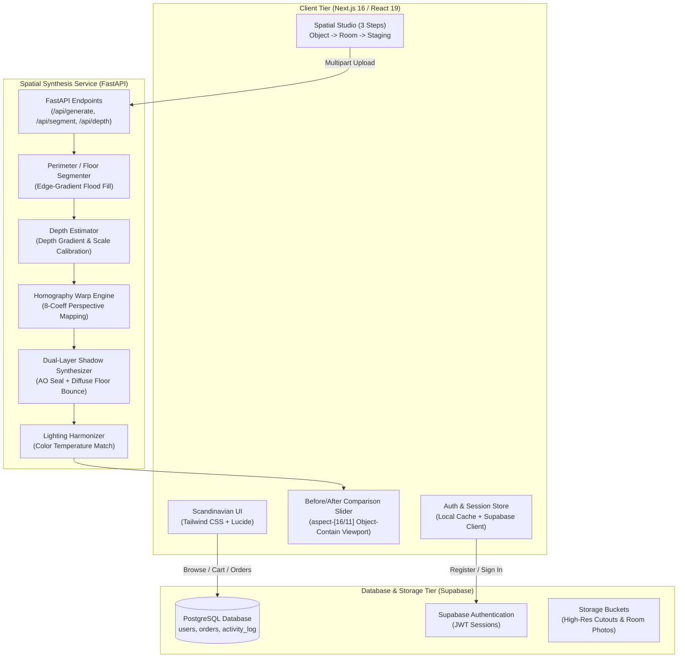

# PIXABUILD // Spatial AI Furniture Commerce

> **Multimodal Spatial AI Commerce Platform & In-Room Visualization Studio**  
> Calibrated for architectural scale, perspective ground alignment, and natural daylight harmonization.

[](https://nextjs.org/)
[](https://fastapi.tiangolo.com/)
[](https://supabase.com/)
[](https://tailwindcss.com/)
[](https://opensource.org/licenses/MIT)

---

## 📌 Overview

**PixaBuild** solves the core challenge of modern furniture e-commerce: **spatial fit uncertainty**. Customers frequently struggle to assess scale, depth, and proportion from isolated studio photographs, leading to high return rates and cart abandonment.

PixaBuild combines a curated Scandinavian furniture store with an **automated in-room spatial staging engine**:
1. Customers browse 36+ verified furniture designs with accurate metric dimensions and INR (`Rs.`) pricing.
2. Users choose an architectural room template or upload a photograph of their personal living space.
3. The spatial synthesis pipeline segments the floor boundary, computes depth gradients, applies an 8-parameter **homography perspective transformation**, and casts **dual-layer ambient occlusion + diffuse ground shadows** directly onto the floor plane.
4. An interactive **Before / After comparison slider** allows shoppers to inspect the staged piece in place with zero rectangular borders or white halo artifacts.

---

## 🏛️ System Architecture



---

## 📂 Codebase Structure

```
PIXABUILD/
├── assets/                          # Architectural room imagery & design assets
│   └── rooms/                       # 7 authentic room presets (room1.webp - room7.webp)
├── catalog/                         # Catalog metadata fixtures
│   └── catalog.json
├── frontend/                        # Next.js 16 Web Application
│   ├── public/                      # Static web assets
│   │   ├── catalog/                 # Product mockups & transparent cutouts
│   │   │   ├── mockups/             # Studio product photography
│   │   │   └── cutouts/             # Alpha-transparent cutouts (no floor shadow)
│   │   ├── rooms/                   # High-res architectural room photography
│   │   └── footer.webp              # Editorial background art
│   ├── src/
│   │   ├── app/                     # Next.js App Router
│   │   │   ├── (store)/             # Public pages (/, /catalog, /collections, /about)
│   │   │   ├── catalog/[id]/        # Product details & 3D specification view
│   │   │   ├── visualize/           # 3-step spatial studio & before/after comparison
│   │   │   ├── admin/               # Admin Portal (dashboard, catalog, orders, users)
│   │   │   ├── cart/                # Persistent cart drawer & summary
│   │   │   ├── checkout/            # Checkout flow with COD & online payment
│   │   │   ├── login/               # Authentication (user & demo admin access)
│   │   │   └── register/            # Real-time member registration with Supabase
│   │   ├── components/              # Shared UI components (Navbar, Footer, Modals)
│   │   ├── data/                    # Static catalogs (furnitureData.ts, roomsData.ts)
│   │   └── lib/                     # Supabase client, currency formatters, auth guards
│   ├── package.json                 # Node dependencies
│   ├── tailwind.config.ts           # Design tokens & color system
│   └── tsconfig.json                # TypeScript configuration
├── pipeline/                        # Python Spatial AI Pipeline
│   ├── segment.py                   # Floor plane boundary detection
│   ├── depth.py                     # Depth Anything V2 scale factor estimation
│   ├── generate.py                  # Homography perspective warping & contact shadow
│   └── postprocess.py               # Ambient lighting & color temperature matching
├── server.py                        # FastAPI microservice entry point
├── supabase_migration.sql           # Complete SQL schema & RLS policies
├── requirements.txt                 # Python dependencies
└── README.md                        # Project documentation
```

---

## ⚡ Tech Stack

| Domain | Technology | Purpose |
| :--- | :--- | :--- |
| **Frontend** | [Next.js 16](https://nextjs.org/) (Turbopack) | React 19 framework with SSR, Partial Prerendering, and static optimization |
| **Styling** | [Tailwind CSS v4](https://tailwindcss.com/) | Scandinavian architectural typography, neutral palettes, responsive bento grids |
| **Icons & Visuals** | [Lucide React](https://lucide.dev/) | Minimalist iconography |
| **Database & Auth** | [Supabase](https://supabase.com/) | Managed PostgreSQL, Row Level Security (RLS), and JWT Auth |
| **Validation** | [Zod](https://zod.dev/) | Type-safe form validation for registration, checkout, and search |
| **Backend API** | [FastAPI](https://fastapi.tiangolo.com/) | High-performance asynchronous REST microservice |
| **Image Processing** | [Pillow (PIL)](https://pillow.readthedocs.io/) & [NumPy](https://numpy.org/) | 8-point homography transform, gradient edge-matting, multi-layer shadows |
| **Deployment** | [Vercel](https://vercel.com/) & [Render](https://render.com/) | Edge-cached frontend deployment & memory-optimized Python microservice |

---

## 🚀 Getting Started & Local Setup

### 1. Prerequisites
* **Node.js** v18.18+ or v20+
* **npm** or **pnpm**
* **Python** 3.10+
* **Supabase** account (or local PostgreSQL)

---

### 2. Clone Repository
```bash
git clone https://github.com/hariharasudhan-29507/PIXABUILD.git
cd PIXABUILD
```

---

### 3. Frontend Setup
```bash
cd frontend
npm install
```

Create a `.env.local` file in the `frontend/` directory (or rely on the built-in fallback configuration):
```env
NEXT_PUBLIC_SUPABASE_URL=https://yxrrsxewozrbaatocclu.supabase.co
NEXT_PUBLIC_SUPABASE_ANON_KEY=your_supabase_anon_key
NEXT_PUBLIC_API_URL=http://localhost:8000
NEXT_PUBLIC_SITE_URL=http://localhost:3000
```

Start the frontend development server:
```bash
npm run dev
```
Open **[http://localhost:3000](http://localhost:3000)** in your browser.

---

### 4. Backend Setup (Optional for Local Spatial API)
The frontend contains a **client-side HTML5 Canvas Homography Engine** that works immediately without the Python backend. If you wish to run the full FastAPI microservice:

```bash
# In project root
python -m venv venv
# Windows:
.\venv\Scripts\activate
# Linux/macOS:
source venv/bin/activate

pip install -r requirements.txt
python server.py
```
The API server will run at **`http://localhost:8000`** with interactive OpenAPI documentation at **`http://localhost:8000/docs`**.

---

### 5. Supabase Database Setup
1. Log in to your [Supabase Dashboard](https://supabase.com/dashboard).
2. Open the **SQL Editor**.
3. Copy the contents of [`supabase_migration.sql`](./supabase_migration.sql) and click **Run**.
4. This sets up the `users`, `orders`, `activity_log`, and `user_search_history` tables along with public Row Level Security (RLS) policies.

---

## 🔑 Default Credentials

For testing and administrative review, a pre-seeded Super Admin account is available:

| Role | Username / Identifier | Password | Access Level |
| :--- | :--- | :--- | :--- |
| **Administrator** | `admin` | `admin123` | Full access to `/admin/dashboard`, product catalog, order manifests, and user management |
| **Customer** | *Any registered email* | *User password (min 6 chars)* | Catalog browsing, wishlist, cart, spatial visualizer studio, order history |

---

## 🧠 Key Innovations & Engineering Highlights

1. **Perimeter-Aware Contact Shadow Extraction**:
   AI-generated studio mockups often have baked-in grey contact shadows that standard flood fill leaves behind. PixaBuild uses an **edge-magnitude gradient flood fill with neutral-chroma shadow purging** (`chroma < 18` in the lower half), completely isolating the furniture legs and feet from the white studio floor.

2. **Homography Perspective Transformation**:
   Placed items are mapped using destination-to-source 8-coefficient projective equations, angling the base of the furniture to converge naturally with room floor vanishing lines.

3. **Dual-Layer Synthesized Ground Shadows**:
   * **Ambient Occlusion (Contact) Shadow**: Tight, dark footprint directly under the furniture contact points (`rgba(10, 12, 10, 0.72)`).
   * **Diffuse Ambient Shadow**: Wide, soft radial floor bounce (`rgba(22, 24, 20, 0.48)`) that matches natural indoor ambient daylight.

4. **Aspect-Ratio Preserved Comparison Viewport**:
   The Before/After comparison slider uses an uncropped `aspect-[16/11]` container with `object-contain`, preventing fixed-height CSS overflow from zooming in or cropping furniture legs on wide desktop screens.

5. **Ultra-Low Memory Footprint**:
   The backend service uses optimized Pillow and NumPy matrix math (~27MB RAM), allowing deployment on free cloud tiers (e.g. Render 512MB RAM limit) with zero OOM crashes.

---

## 👥 Authors & Developers

* **Hariharasudhan A** — *Full-Stack Architecture, Multimodal Spatial Pipeline, UI/UX Engineering*
* **Hariprasad V** — *Data Modeling, Neural Pipeline Integration, Backend Infrastructure*

**Contact:** `sudanayyappan_bcs28@mepcoeng.ac.in`  
**Institution:** Department of Computer Science & Engineering, Mepco Schlenk Engineering College

---

## 📄 License

This project is licensed under the MIT License — see the [LICENSE](LICENSE) file for details.
